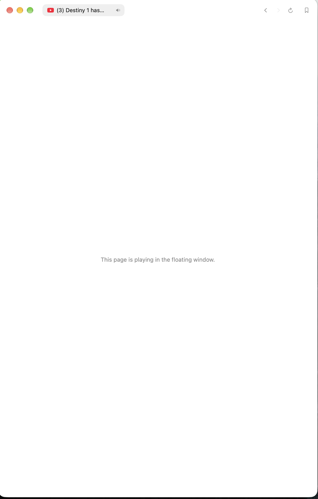
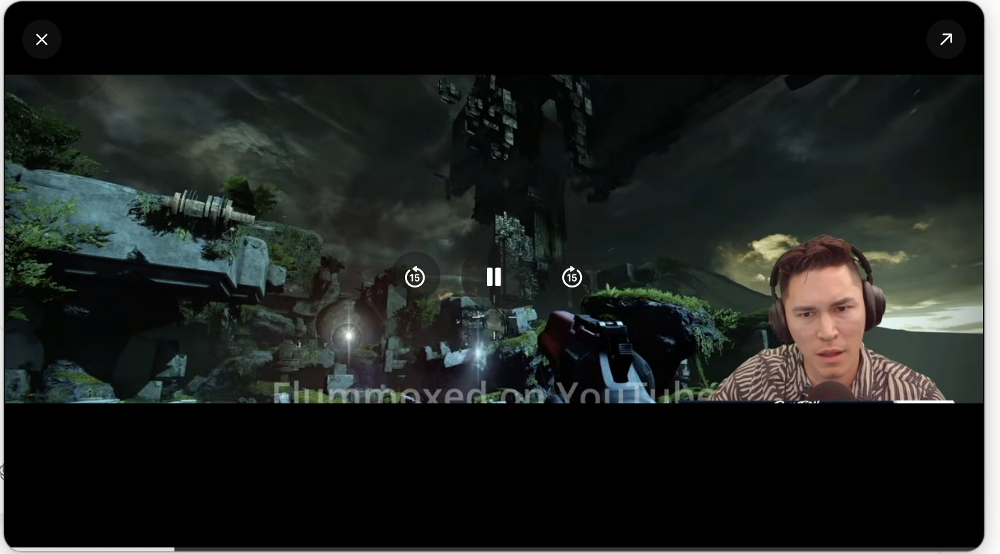
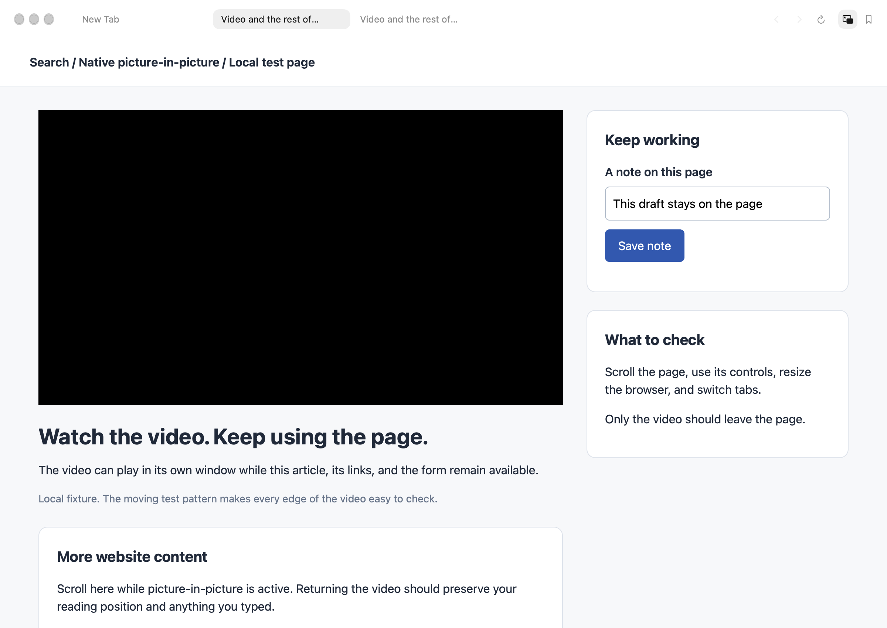
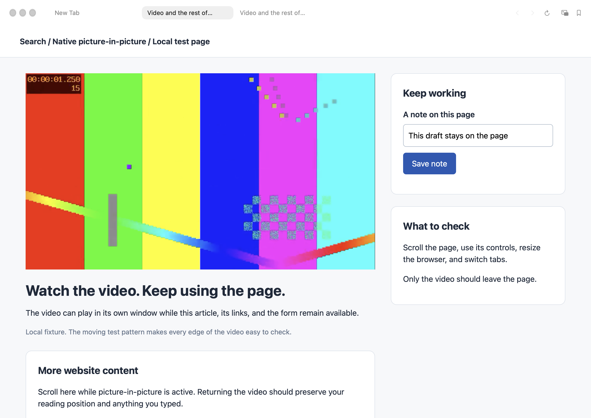
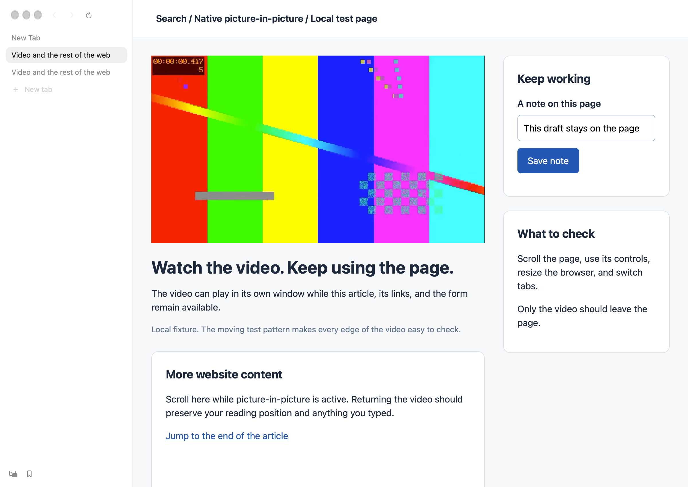
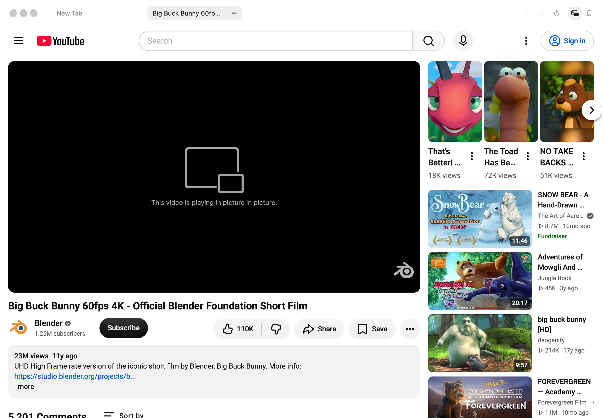
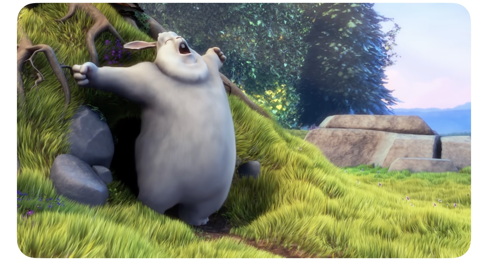

# Picture-in-picture investigation

Assessed 2026-10-11 against `59c1b4e1ddf15433701a687e9292d607589fe20d`, which was also upstream `main` at the time. GitHub inventory covered all 40 open issues and 51 open pull requests, plus relevant closed reports and pull requests.

## Reported behavior

The screenshots below were supplied by the reporter from live YouTube playback. They are original captures, not generated fixtures. The video capture is retained at its original resolution (about 1 MiB) so the clipping remains visible.

*Comments and the rest of YouTube cannot be used while the video floats. The toolbar also has no picture-in-picture button beside Bookmarks.*

*The reporter observed clipping when entering picture-in-picture and resizing its window.*

*The reporter needed to resize the browser or switch tabs to make the page appear again.*

## Findings and existing work

| Problem | Code and evidence | Existing work |
| --- | --- | --- |
| No toolbar button | `TabBar.swift` places `BookmarkDoor` immediately after the navigation controls; `Side.swift` has a separate bookmark location. The command already exists as `view.float` / ⇧⌘P. | No matching open issue or PR found for a PiP toolbar button. |
| Website content disappears | `Float.lift` removes the whole `WKWebView` from its stage and adds it to an `NSPanel`. `Isolate.on` hides the rest of the page. `Page` and `PaneStage` deliberately remove the page while `tab.floating` is true. | [#257](https://github.com/driceroland/Search/issues/257) discusses native PiP, but the merged mitigation retained the whole-page move. Both active video PRs also retain it. |
| Video clipped or distorted | The page is resized on entry, exit, and panel resize. The panel assumes 440:247 instead of the media's intrinsic ratio. Injected CSS overrides the video and its ancestors, and depends on player layout and WebKit painting catching up. These are confirmed design constraints; the exact clipping in the supplied screenshot has not been reproduced. | [#543](https://github.com/driceroland/Search/issues/543), [#547](https://github.com/driceroland/Search/pull/547), and [#562](https://github.com/driceroland/Search/pull/562). #547 preserves source geometry with native cropping. #562 uses CSS scaling and temporary snapshots while layout settles. |
| Blank page after return | `Float.drop` removes the page and relies on stage reconciliation to reattach it. `Isolate.off` separately waits for a size change or timeout before restoring page styles. The screenshot alone does not prove which step failed. | [#8](https://github.com/driceroland/Search/issues/8) and merged [#9](https://github.com/driceroland/Search/pull/9) describe this exact symptom; their fix is already present. #562 addresses related return-layout timing, but does not establish that this recurrence is fixed. |

The maintainer's [October 10 comment on #547](https://github.com/driceroland/Search/pull/547#issuecomment-6096110228) schedules it after 1.0.5, followed by meeting/page floating in #584. #562 overlaps the video transition code and needs coordination with #547. Neither has merged. Avoid presenting their work as unowned or duplicating those patches without coordination.

## Native PiP feasibility

A standalone WKWebView experiment on macOS 27.0.1 used a local H.264 fixture and a nonpersistent website store. With the guarded `_setAllowsPictureInPictureMediaPlayback:` preference enabled, a call to `webkitSetPresentationMode('picture-in-picture')` from an isolated JavaScript world succeeded without a page click. The reported presentation mode became `picture-in-picture`; the page stayed 960×720 and the video box stayed 640×360. This verifies platform feasibility, not the complete Search integration or live YouTube behavior.

Apple documents the [presentation-mode API](https://developer.apple.com/documentation/webkitjs/adding_picture_in_picture_to_your_safari_media_controls). The macOS enabling preference is [private WebKit API](https://github.com/WebKit/WebKit/blob/main/Source/WebKit/UIProcess/API/Cocoa/WKPreferencesPrivate.h); it must be checked before use. Search already uses guarded private selectors for other WebKit features.

[Apple's current PiP guide](https://support.apple.com/guide/safari/play-web-videos-ibrw27291639/mac) includes 10-second backward/forward controls, dragging, resizing, restore, and close. Search's current custom panel adds 15-second skips, a progress line, pinch resizing, flick gestures, and remembered placement. The exact controls exposed by WKWebView must be checked on the supported macOS versions rather than inferred from older reports.

## Implemented behavior

Search requests native video presentation in the owning frame and keeps the original `WKWebView` attached to its stage. It no longer hides website content, imposes video CSS, reparents the page into a custom panel, or repairs the page layout on return. Reports from an isolated script in each frame keep native and site-initiated sessions synchronized, including cross-origin embeds. Entry has a bounded retry for WebKit's closing animation; exit waits for `closeAllMediaPresentations` before another request starts and preserves whether the video was playing. A document/token check prevents resuming a replacement page or a discarded view.

The existing shortcut/menu and automatic-floating preferences share this lifecycle. Manual PiP stays out when its source tab is selected again. Automatic PiP returns when the user returns to its source, as before. Closing or navigating the source, closing its window, and removal of an embedded player clear the session. The native Restore callback selects the source tab and raises its window; this also handles a minimized source window. WebKit otherwise waits for a hidden source document to become visible before completing Restore ([implementation](https://github.com/WebKit/WebKit/blob/main/Source/WebCore/platform/mac/VideoPresentationInterfaceMac.mm), [delegate hook](https://github.com/WebKit/WebKit/blob/main/Source/WebKit/UIProcess/API/Cocoa/WKUIDelegatePrivate.h)). Unsupported media leaves the page alone and reports unavailability for a manual request.

The optional button uses the existing `Door` style directly before Bookmarks in both toolbar layouts. Settings › General › Show picture-in-picture button is off by default, following CONTRIBUTING.md. The button is shown only when there is a supported video or an existing session in that tab. Its accessible label changes between “Picture in Picture” and “Return Video to Page”.

There are no added app dependencies, duplicate playback views, screenshot streams or permanent polling loops. The media observer reacts to media events and relevant DOM changes. The test clips are not app resources. No CPU or memory improvement is claimed without measurements.

## After captures

These are actual Search/WebKit captures, not mockups. Local fixture captures use the isolated `bench picture` harness described in the [fixture README](../../../Tests/Fixtures/PictureInPicture/README.md). They retain their native Retina resolution to keep the small toolbar icon legible. The signed-out YouTube page capture is about 1.4 MiB; the system-window capture is about 240 KiB.

*Only the player gets a PiP placeholder. The article, links and unsaved note remain on the page; the active PiP button is immediately before Bookmarks.*

*The video is back inline, with the same page and unsaved note, without resizing the browser or switching tabs.*

*The same command is available in the sidebar footer. The setting is off by default.*

*Live YouTube smoke test: the site remains visible, including navigation, video details and other content.*

*Separate capture of the system PiP window playing Blender's Big Buck Bunny. The accessibility tree identified Close, Restore, Pause, Skip back 10 seconds and Skip forward 10 seconds. This confirms the controls on this Mac, not on every supported OS.*

*The same implementation presents the portrait fixture at its own proportions, without Search imposing a landscape panel.*

## Validation

Tested on macOS 27.0.1 (26A434), Apple Silicon, against the source revision above.

- Debug app build: passed; no warnings introduced by the PiP code.
- Native PiP integration suite: 47 passed, 0 failed (with screenshot checks). Covers actual WKWebView entry/exit, unchanged document and geometry, editable forms and links, landscape/portrait/cross-origin players, repeated transitions, tab switching, resizing the source browser, automatic behavior, site-initiated PiP, navigation, source closure, multiple windows and unavailable media.
- Existing Split View suite: 92 passed, 0 failed.
- Staged secret scan with Gitleaks 8.30.1 and the repository rules: no leaks found in the implementation; screenshot contents were also visually reviewed.
- XCTest: one existing WebKit file-permission test failure was reproduced on unchanged `main`: `ExtensionFileAccessTests.testFilesAreNeverGrantedButSitesAre` (“WebKit no longer gives a granted file pattern: this test proves nothing”). The other 60 tests passed, including in the final run.
- Live signed-out YouTube: native entry succeeded and the webpage remained present. The system window displayed the video with its native controls. The viewport dimensions stayed unchanged; initial YouTube layout had not settled before the first measurement, so that run does not establish unchanged player-box geometry.

The fixture suite checks page identity, layout, DOM presentation mode, playback state and usable controls. Native Pause and Close were exercised through macOS accessibility, and the real Restore button returned the video inline with playback continuing after adding the source-tab callback and preserving playback state. Early snapshots that temporarily moved the source view during PiP retained a stale player frame; the final entry/return captures avoid that harness side effect. These still do not establish frame-perfect animation on every system. Native window resize gestures could not be reliably exercised through the available automation and need a visible-window manual pass before release. Older supported macOS versions (the project targets macOS 14+) and DRM services have not been tested. Videos inside shadow roots are not enumerated by this implementation.

The enabling preference and native Restore delegate hook are private WebKit API. The preference is guarded with `responds(to:)`; the Restore method is invoked only when WebKit offers that callback. If WebKit removes it or a video rejects PiP, Search does not fall back to moving the whole page. macOS owns the native controls, placement and gestures; Search's custom 15-second skips, progress line, pinch/flick behavior and remembered panel geometry are removed. Stored legacy gesture/geometry settings are left untouched and ignored.

## Upstream coordination

This is a local alternative to the whole-page approaches in #547 and #562. No upstream issue or PR has been published for this branch, and no maintainer approval of the native direction is implied. CONTRIBUTING.md asks to discuss substantial changes first; use the existing #257 discussion or a focused follow-up before submitting this architectural change. The local PR draft identifies the guarded private API and the native-control tradeoff explicitly.

The overlapping #543 roadmap entry remains until the maintainer chooses a direction. This change does not implement meeting/page floating in #584 and does not claim every streaming-site PiP report is resolved.
