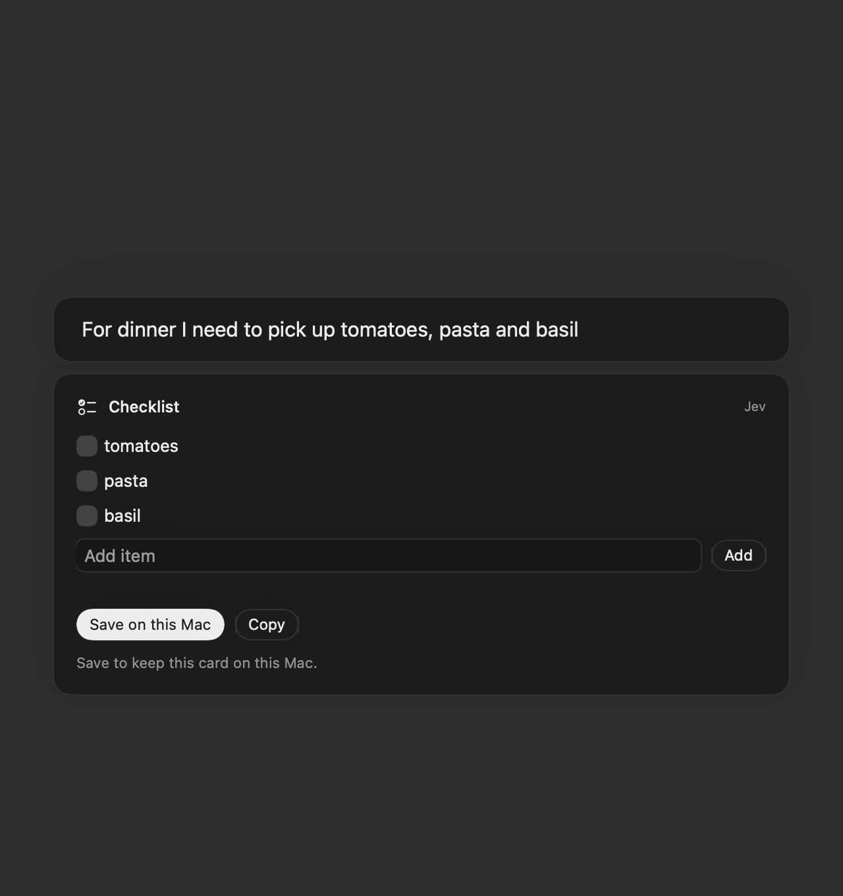

# Add native quick tools to Search’s home screen

Typing a short task into Search currently means leaving the home screen to find a website or opening another app. This change turns the same input into a small, usable native component: a timer, calculation, checklist, note, conversion or email draft appears beneath the field while the user types.

The component replaces the normal search-suggestion rows while it is visible. **Enter still searches the exact text with the selected engine (Google by default)**, so the user can choose between completing the task inline and continuing to the web. There is no Quick tools dropdown.

## Why it’s useful

Small tasks become quick interactions without opening another page or switching apps. A grocery request becomes a checklist, a number becomes a conversion, and a thought becomes a note that stays on the home screen. Native controls keep the interaction familiar and avoid adding a web-based component renderer or a new runtime to a small browser.

## Examples

### A checklist beneath the search field

Type `make a shopping list with milk, eggs and bread`, then check off items or add more. With Jev enabled, conversational wording such as `For dinner I need to pick up tomatoes, pasta and basil` selects the same component and its relevant items. The search row and component picker stay out of the way.



### Notes that stay on the home screen

Type `note Call Sam`, edit the text and choose **Save note**. The editor contains no title input or Copy button. Saved notes appear as small cards when the home-screen input is empty; clicking a note opens it for editing or deletion.


Screenshots are captures of native SwiftUI views with synthetic example content, not design mockups.

## Component use cases

| Component | Example input | What it provides |
|---|---|---|
| Note | `note Call Sam` | Minimal editor and a saved home-screen note. |
| Checklist | `make a shopping list with milk, eggs and bread` | Checkboxes, item entry and local saving. |
| Timer | `timer 5 minutes` | Start, pause, resume and reset. |
| Stopwatch | `stopwatch` | Count elapsed time. |
| Calculator | `18% of 3450` | A computed result without opening a page. |
| Currency / unit conversion | `100 USD to EUR` or `5 miles in km` | Dated exchange-rate results or local unit conversion. |
| Reminder | `remind me to call the dentist tomorrow` | An editable local reminder card; no notification scheduling. |
| Color | `#FF6B35` | Native color picker and hex value. |
| Expense | `spent £12 on lunch` | Editable amount, currency, description and category. |
| Trip | `trip London tomorrow` | Editable destination and travel dates; no booking. |
| Contact | `contact Ada ada@example.com` | A local contact card; no Contacts integration. |
| Bookmark | `bookmark https://example.com` | A saved link card with a note. |
| Countdown | `countdown December 25, 2027` | Days until a date. |
| Time zone | `time in Tokyo` | Current or chosen time across zones. |
| Random | `roll 2d6` or `flip a coin` | Dice, a coin flip or a choice between named options. |
| Email composer | `send an email to alex@example.com that says See you at five` | Editable recipient, subject and body; Continue in Mail opens a draft for review and sending. |
| Inbox | `email` | An explicit “not connected” state and Open Mail action. Live inbox access is not implemented. |

Bill splitting, calendar events, habit tracking, goal tracking and polls are outside this catalog. Their stored type identifiers remain decodable so removing those components does not discard unrelated saved notes or cards. The classifier retains them as internal rejection labels, avoiding pressure to relabel an unsupported calendar event as a supported reminder; the routing gates reject all five types.

## Behavior and implementation

- **Optional, off by default.** Local Quick tools and Jev typing intelligence have separate switches in Settings → AI. Page AI has separate settings and consent.
- **Local first.** Recognized commands, calculations, unit conversion and explicit email drafts work without a Jev key. Jev handles natural-language intent and selects verbatim source spans for editable content and email recipients. It does not generate or execute UI code, invent recipients or send messages.
- **Native interface.** SwiftUI/AppKit controls, stable card identity, short transitions and Reduce Motion support. Pending results retain their shape with stale controls disabled; cards do not steal focus from typing.
- **Normal search remains available.** A visible tool suppresses the suggestion list. Arrow keys cannot select invisible suggestions, and Enter bypasses a previously selected hidden row or autocomplete destination to search the typed text.
- **Local persistence.** Users explicitly save cards on this Mac. Notes appear directly on the idle home screen; the Saved menu provides access to other saved cards. No account or cross-device sync is added.
- **Small scope.** Reuses the existing AI key storage and protected transport. No new package dependencies, embedded JavaScript UI or downloaded model are required.

## Privacy and limits

Eligible home-screen typing is sent to the selected TypeSafe/OpenRouter provider only when Jev is enabled and a key is supplied. Private tabs, page address overlays, site-search modes, browser commands and ordinary URL/path input are excluded. No page content, history, cookies or other tabs accompany the request. Requests are restricted to the configured provider host, redirects are refused, responses are bounded, and stale/cancelled replies are ignored.

Currency conversion requests send only currency codes to Frankfurter, use dated daily reference rates and perform amount calculations locally. Rates are indicative, cached in memory and validated for freshness.

Keys use the existing Keychain path in eligible signed builds; isolated demos keep keys in memory. No credentials are included in source, screenshots or test fixtures. Editing an email’s fields stays local; sending requires continuing to the mail app and pressing Send there. There is no live inbox connection, automatic sending, calendar/Contacts sync or reminder/timer notification support.

## Validation

On October 6, 2026, 29 offline tests passed (three live checks skipped in the offline run). Separate live runs passed all 15 intent-routing cases, all six natural-language/detail cases and the actual mounted search-field flow.

Focused automated checks cover native search-field typing, retained focus, component visibility, restoration of ordinary suggestions, literal Enter-to-search navigation, cancellation, currency validation, supported/retired routing, saved-data compatibility and light/dark native rendering. Live Jev checks use synthetic requests and an ephemeral key; normal test runs skip them. These are integration and smoke checks, not an accuracy guarantee for arbitrary wording.

```sh
SEARCH_PROBE=jev-tests swift test -c release --arch arm64 -Xswiftc -Osize \
  --filter 'JevTests|HomeToolsIntegrationTests|IntentToolsTests'
```

This experiment is prepared for review in the personal fork; it is not submitted to the upstream project.
