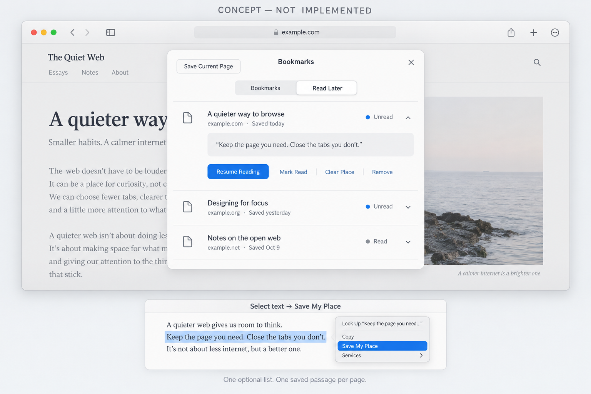

# Read Later with Save My Place

I keep tabs open because I haven't finished reading them. Could Search offer a local Read Later list with explicit read/unread status?

- Off by default, enabled in Settings, using the existing Bookmarks UI.
- Save, open, mark read/unread, and remove. Opening does not mark an item read.
- Keep URL, title, saved date, and status across relaunches. Saving the same exact URL preserves its status and saved place; query parameters remain distinct.
- Share the list across normal windows and Spaces. Open items with the current Space's sign-ins.
- Disabling hides the feature without deleting saved items. Existing bookmarks stay unchanged.

**Save My Place**, within the same feature: select a passage to save one quote with limited surrounding text. This adds the page if needed, or replaces its saved place without changing read status. **Resume Reading** opens the page and scrolls to/highlights a unique text match. Ordinary visits do not jump.

If the passage is missing, ambiguous, or the page redirects elsewhere, retain the quote and explain that restoration failed. Stop if the user starts scrolling. A place can be replaced or cleared; removing its item deletes it too.

Start with top-level HTTP(S) HTML text. Exclude private tabs, editable fields, PDFs, and frames. No sync, background requests, offline archives, automatic scroll tracking, AI, or new dependencies.

Checks would cover persistence, keyboard access, private/editable exclusions, changed or repeated text, redirects, and coexistence with Find and Reader.

Would this fit Search after the current fixes-only release? Please confirm the shared list and Bookmarks placement, and whether the queue and Save My Place should land in separate PRs. I'd wait for agreement before implementation.

*Concept mockup for discussion; not an implemented feature or a screenshot of the current app.*
