# Connected search evidence

These are **native component fixtures**, rendered by AppKit from the production `Omnibox.swift`, `AddressField` and `Design.swift`. History, favicons and Browser are storage-free stand-ins; the document behind the composer is a synthetic SwiftUI background. No Browse process, WebKit session, profile, clipboard, keychain or network request is involved. These images are not full-app acceptance evidence.

Run on macOS from the repository root:

```sh
Tests/OmniboxFixture/run.sh
Tests/OmniboxFixture/run.sh docs/screenshots --before
```

The before command compiles `Omnibox.swift` from base commit `3241006e72b8b4c4212095552eaed8f9d99f226a`; the after command compiles the checkout. The before composer shows the old address overlay. The centered composer captures below are historical; New Tab now uses its own tab address field, shown in the current evidence below. A selected history row and a search fallback use synthetic data.

Captured October 15, 2026 on Apple Silicon, macOS 27.0.1 (26A434). The window is 1440 × 900 points; AppKit captures at the host's native backing scale (2880 × 1800 pixels here). PNGs remain under 300 KB. The GIF captures actual native component appearance/disappearance between run-loop turns, with a requested 1/30-second interval plus capture overhead and 30 fps playback. It is not an assembled transition between static before/after pictures. Transitions become immediate if the host has Reduce Motion enabled; the harness reports that preference without changing it.

| State | Before | After |
| --- | --- | --- |
| Home, light |  |  |
| Home, dark |  |  |
| Historical overlay, light |  |  |
| Historical overlay, dark |  |  |


The fixture checks that showing suggestions does not move the native field, that a 420-point fitted pane contains the field, that the field exposes its accessibility label/help, and that the production field delegate handles Down and Return. It sends native mouse events to the second suggestion to verify overflow hit-testing, using the ordinary Home layout and a fitted overlay. This uses fixture Browser callbacks; it does not verify Browser's actual tab creation, private stores, extension overrides, split routing or cancellation.

## New Tab in its own tab

`Tests/TabEntryFixture/run.sh` runs an opt-in XCTest fixture using the real Browser, TabBar, TabAddressField and child suggestion panel. It appends a draft after the existing “Fixture document” tab, keeps that source active, and types through the native field editor. The backdrop is synthetic; parent/child native windows are composited at their actual positions. These are component fixtures, not full-app screenshots. The fixture uses an owned `SEARCH_PROBE` world, no real profile, clipboard or keychain, and does not load a public webpage.

| State | Light | Dark |
| --- | --- | --- |
| Empty draft after existing tab | 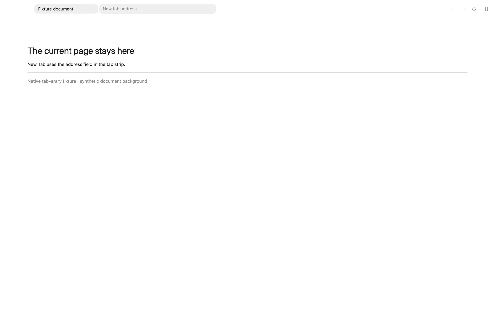 | 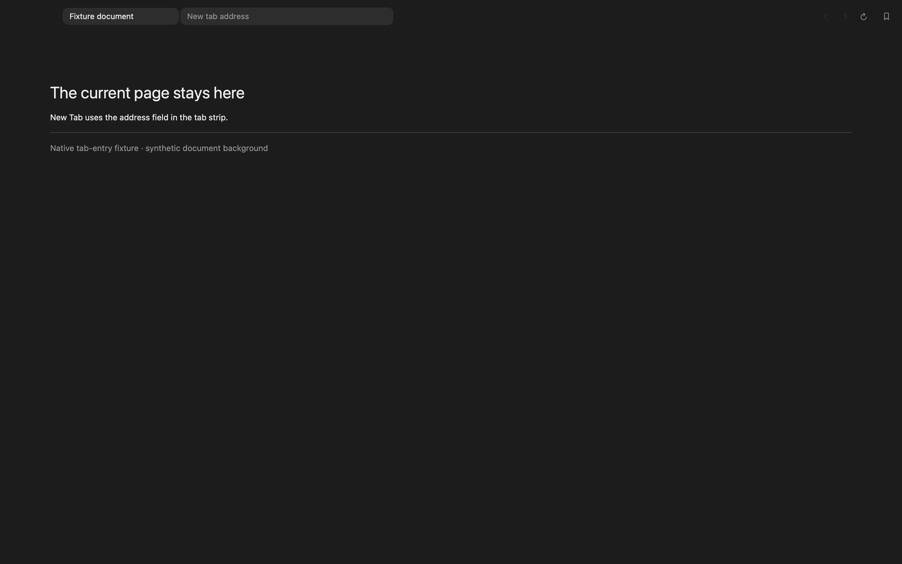 |
| Connected suggestions in draft | 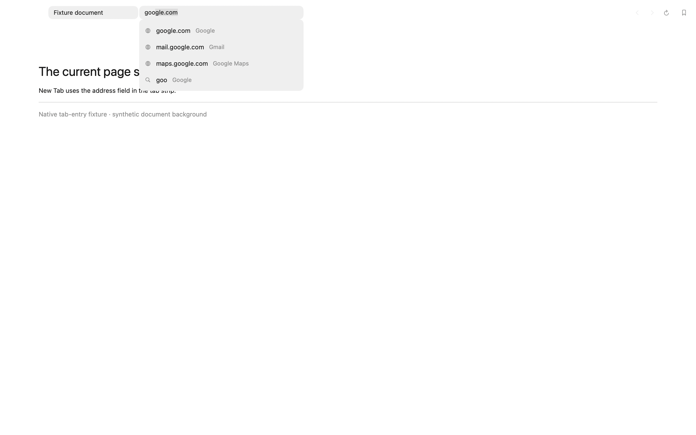 | 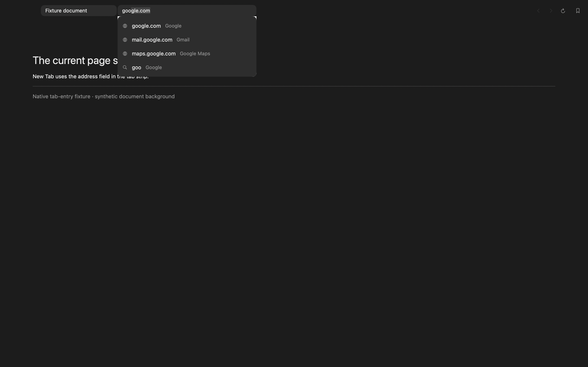 |

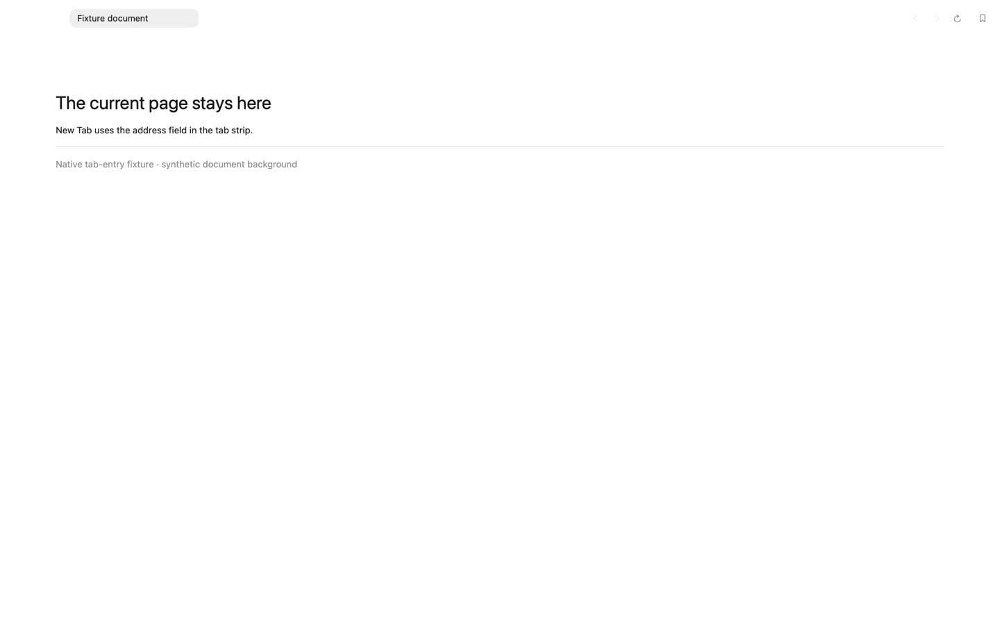

The GIF samples the live native views across New Tab, typing and Escape (16 frames, requested 35 ms between samples plus capture overhead, 100 ms playback per frame). It is motion evidence, not a timing or performance measurement. These PNGs retain the native 2880 × 1800 backing scale to keep the small tab-field text legible (511–861 KiB, within the documented Retina exception of 1 MiB).

The current Browser/native-field regression run passed 47 tests in an owned disposable preview worktree with the known Store missing return repaired locally. This final run included the expanded screenshot/GIF fixture and the background Home draft, split/rename and move-to-Space regressions. The PR's unmodified build remains blocked by that baseline error ([#9](https://github.com/BryanZaneee/Browse/issues/9)); the local repair is not part of this feature. A separately identified, ad-hoc signed dev preview was also launched with its own test-world fallback and the tab/dropdown placement checked visually. No normal Browse profile was used.

Keep the PR draft pending build/isolation gates [#9](https://github.com/BryanZaneee/Browse/issues/9)/[#10](https://github.com/BryanZaneee/Browse/issues/10) and remaining full-app acceptance: plus/menu/Command-T, URL/search/history submission, cancellation, existing-page form preservation, private tabs, approved extension overrides, top/sidebar/split layouts, IME, VoiceOver and Reduce Motion. Capture a full-app interaction recording before marking ready. The new regression coverage checks draft identity/placement, cancellation, submission, private store separation, background submission and native keyboard completion; it does not replace those full-app checks.


## Saved-data notices

`Tests/PersistenceFixture/run.sh` captures the production AppKit alerts with synthetic `windows.json` failures in an isolated XCTest process. Before this change, save errors and failed quarantine had no notice. These are native component renders; transparent window material is flattened onto `NSColor.windowBackgroundColor` using the selected appearance. Captured on macOS 27.0.1 arm64. No real saved-data contents are used, and no motion was changed.

| Notice | Light | Dark |
| --- | --- | --- |
| Save failed | 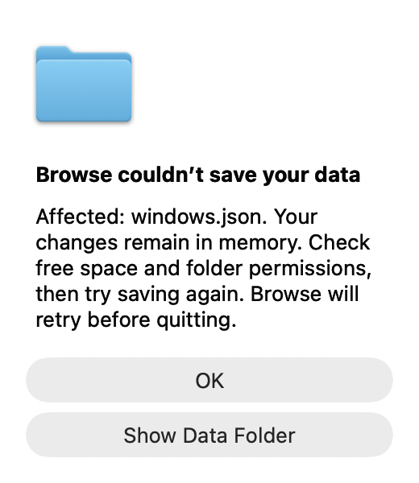 | 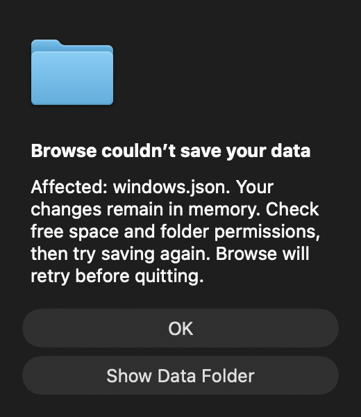 |
| Original preserved | 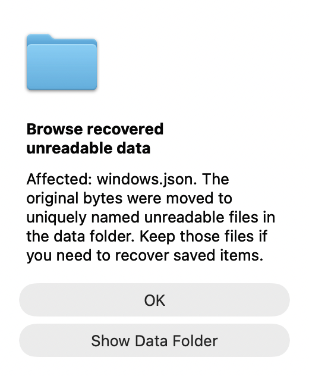 | 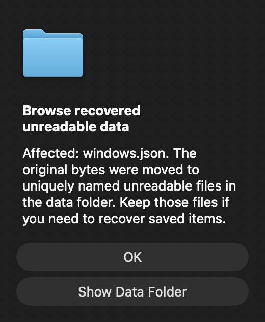 |
| Quit decision | 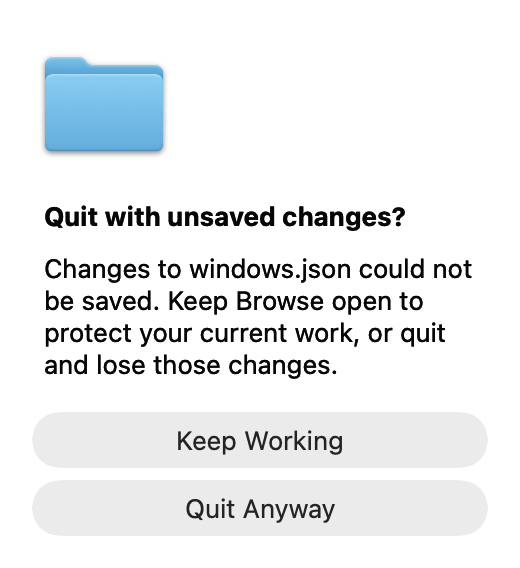 | 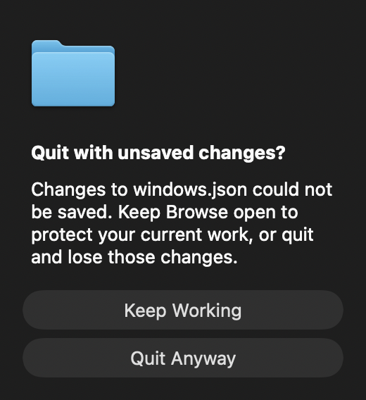 |

The quit alert defaults to Keep Working. Unit tests exercise cancellation, explicit quit, retry and notice identity; manual VoiceOver and real disk-full/hardware interruption remain separate acceptance checks.
