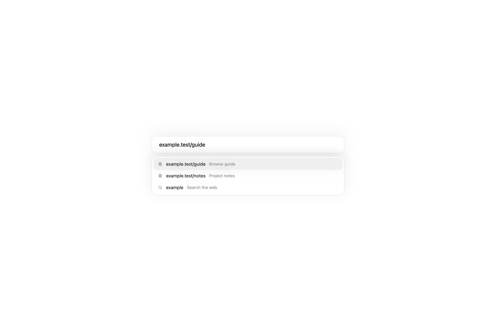
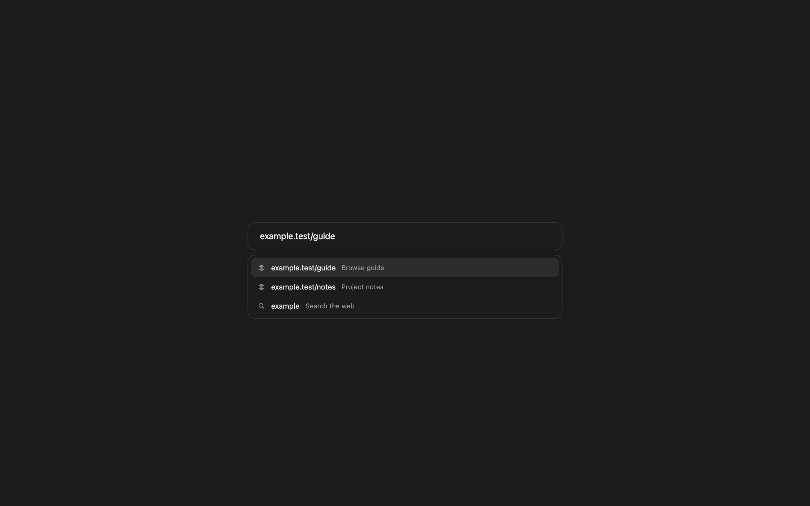
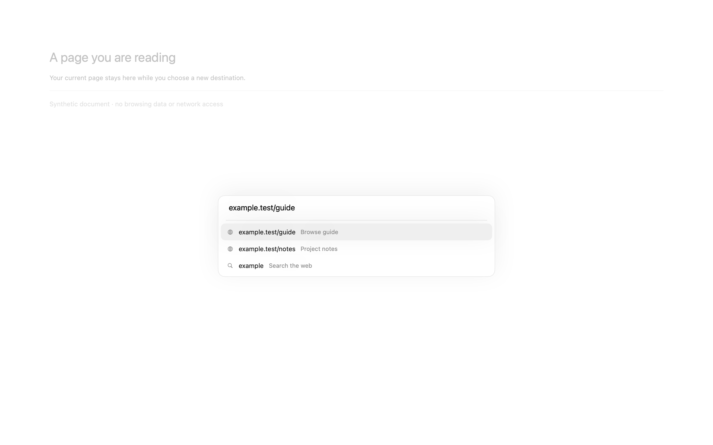
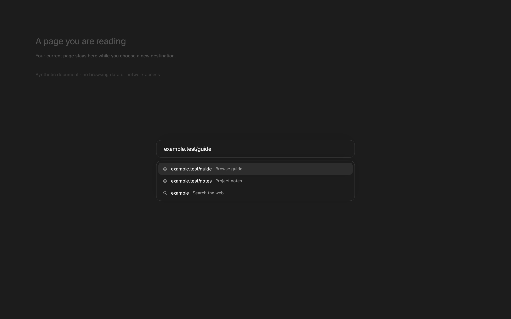
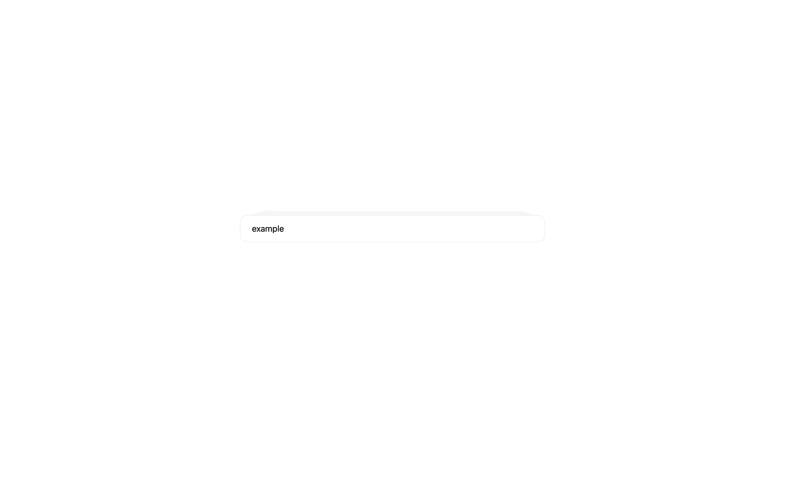

# Connected search evidence

These are **native component fixtures**, rendered by AppKit from the production `Omnibox.swift`, `AddressField` and `Design.swift`. History, favicons and Browser are storage-free stand-ins; the document behind the composer is a synthetic SwiftUI background. No Browse process, WebKit session, profile, clipboard, keychain or network request is involved. These images are not full-app acceptance evidence.

Run on macOS from the repository root:

```sh
Tests/OmniboxFixture/run.sh
Tests/OmniboxFixture/run.sh docs/screenshots --before
```

The before command compiles `Omnibox.swift` from base commit `3241006e72b8b4c4212095552eaed8f9d99f226a`; the after command compiles the checkout. The before composer shows the old address overlay, since the deferred New Tab action did not exist on the base. A selected history row and a search fallback use synthetic data.

Captured October 15, 2026 on Apple Silicon, macOS 27.0.1 (26A434). The window is 1440 × 900 points; AppKit captures at the host's native backing scale (2880 × 1800 pixels here). PNGs remain under 300 KB. The GIF captures actual native component appearance/disappearance between run-loop turns, with a requested 1/30-second interval plus capture overhead and 30 fps playback. It is not an assembled transition between static before/after pictures. Transitions become immediate if the host has Reduce Motion enabled; the harness reports that preference without changing it.

| State | Before | After |
| --- | --- | --- |
| Home, light |  |  |
| Home, dark |  |  |
| Overlay, light |  |  |
| Overlay, dark |  |  |



The fixture checks that showing suggestions does not move the native field, that a 420-point fitted pane contains the field, that the field exposes its accessibility label/help, and that the production field delegate handles Down and Return. It sends native mouse events to the second suggestion to verify overflow hit-testing, using the ordinary Home layout and a fitted overlay. This uses fixture Browser callbacks; it does not verify Browser's actual tab creation, private stores, extension overrides, split routing or cancellation.

Full-app captures and integration tests remain gated by the baseline build failure ([#9](https://github.com/BryanZaneee/Browse/issues/9)) and test-world isolation ([#10](https://github.com/BryanZaneee/Browse/issues/10)). After those land, run `swift test --filter NewTabTests` and verify plus/menu/Command-T entry, URL/search/history submission, Escape/click-away/Command-W cancellation, existing-page form preservation, private tabs, approved extension new-tab pages, top/sidebar/split layouts, IME, VoiceOver and Reduce Motion. Capture a real full-app interaction recording before marking the feature ready.
