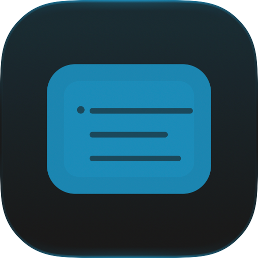

# Browse build icons

Native icon exports on Apple Silicon, macOS 27.0.1 / Xcode Swift 6.4.
The fallback PNG keeps the existing plate margin; Composer exports the plate
canvas, which macOS positions in the Dock. These are asset renders, not app
screenshots. No browser profile was opened. The pre-fix generator cannot compile.

| Fallback | Composer light | Composer dark | Composer tinted dark |
|---|---|---|---|
|  |  |  |  |

Reproduce from the repository root with Xcode's Icon Composer installed:

```sh
icon_tmp=$(mktemp -d)
swift Icon/icon.swift "$icon_tmp/AppIcon.iconset" "$icon_tmp/AppIcon.icon"
cp "$icon_tmp/AppIcon.iconset/icon_512x512.png" docs/screenshots/build-icons/fallback.png
icon_tool="$(xcode-select -p)/../Applications/Icon Composer.app/Contents/Executables/ictool"
"$icon_tool" "$icon_tmp/AppIcon.icon" --export-image --output-file docs/screenshots/build-icons/light.png --platform macOS --rendition Default --width 512 --height 512 --scale 1
"$icon_tool" "$icon_tmp/AppIcon.icon" --export-image --output-file docs/screenshots/build-icons/dark.png --platform macOS --rendition Dark --width 512 --height 512 --scale 1
"$icon_tool" "$icon_tmp/AppIcon.icon" --export-image --output-file docs/screenshots/build-icons/tinted.png --platform macOS --rendition TintedDark --width 512 --height 512 --scale 1 --tint-color 0.6 --tint-strength 0.75
rm -r "$icon_tmp"
```

`./build.sh debug` additionally compiles `Assets.car` when actool supports Icon
Composer, and always packages `AppIcon.icns`. Dock behavior on older macOS and
Intel remains untested. App launch awaits the isolation repair in #10.
