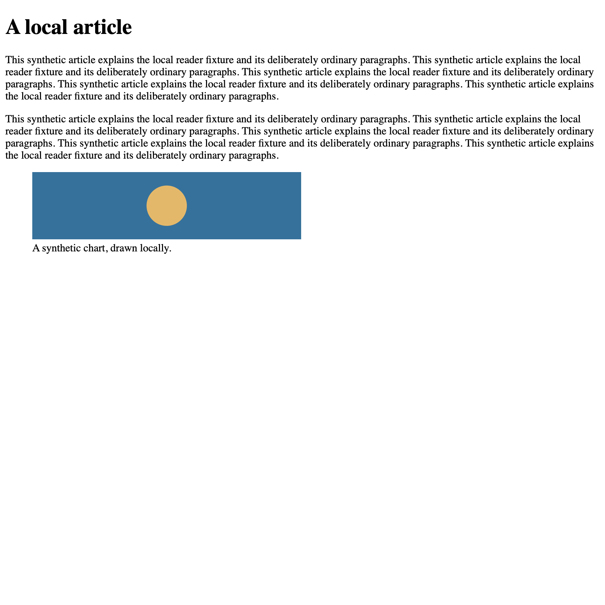
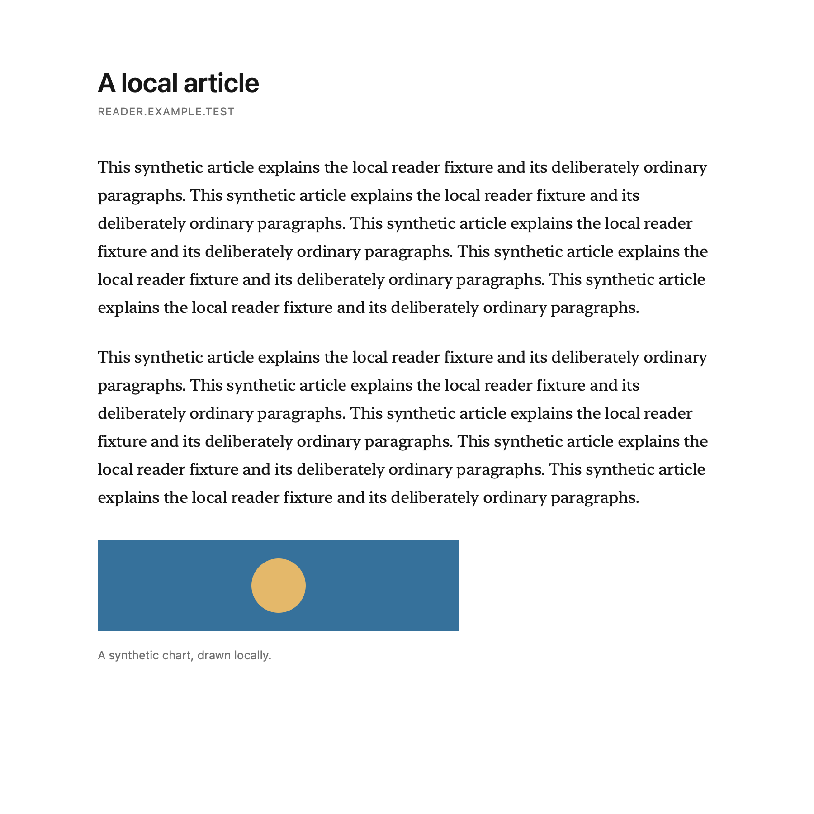
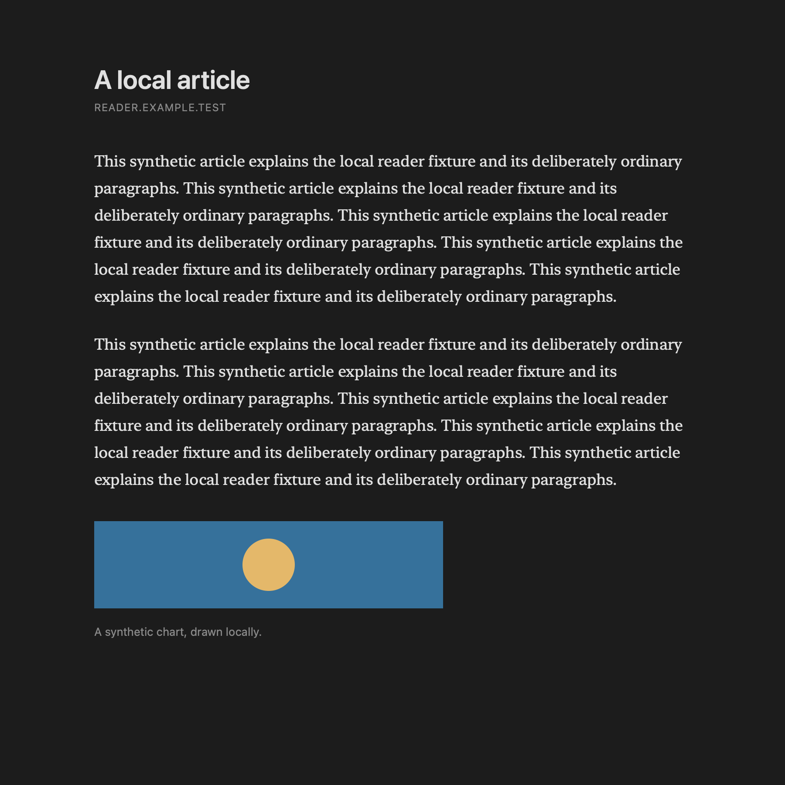
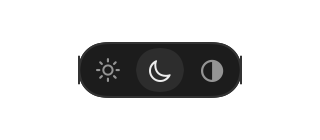

# Reader fixtures

These are native WebKit article snapshots and separate native SwiftUI appearance-control renders from synthetic local fixtures. They are not whole-browser screenshots. Fixture CSP blocks external network resources; no real article or browsing data is captured.

| Original local page | Light reader | Dark reader |
| --- | --- | --- |
|  |  |  |

| Light controls | Dark controls |
| --- | --- |
|  |  |

Reproduce on macOS in an owned XCTest world:

```sh
BROWSE_READER_SCREENSHOTS="$PWD/docs/screenshots/reader" python3 Tests/run-unit-tests.py --filter ReaderTests
```

The normal suite checks split-tab appearance independence and live native window appearance. The capture tests run only with the output variable set. No new UI animation is introduced; the controls keep full opacity for contrast. Each button has an explicit accessibility label and selected trait. Interactive keyboard/VoiceOver validation belongs to the owned visible preview.
