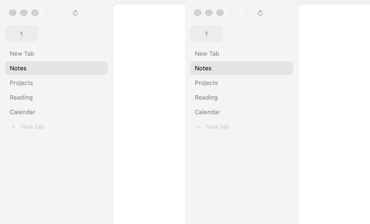
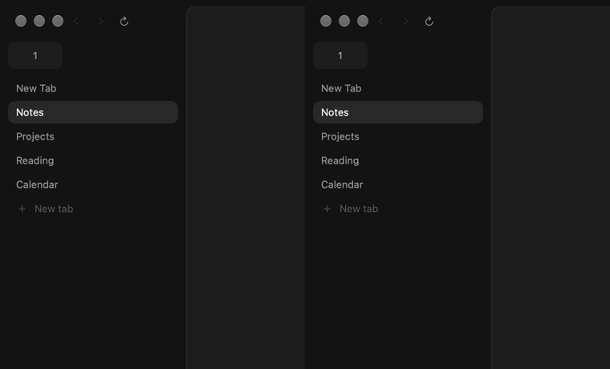

# Sidebar selection motion

Before (left, main `6294b6a`) and after (right). These are frames drawn by Search's native window in an isolated, hidden test world, selecting Calendar from Notes. Both recordings use the same tabs and window size, with Reduce Motion off. Playback follows the recorded timestamps, with a pause before selection and after settling.




To capture another selection in an existing disposable bench world, select the starting tab, let it settle, then record:

```sh
./bench --world NAME select START_ID
./bench --world NAME film select TARGET_ID /tmp/selection 25 0.02
```

The command writes numbered PNGs and reports each frame's elapsed milliseconds. The baseline uses the same recorder with the original selection animation.
