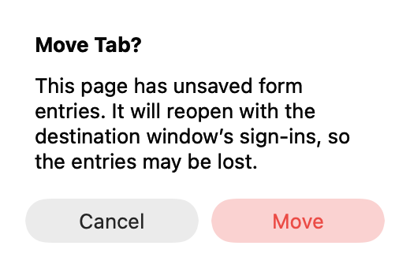
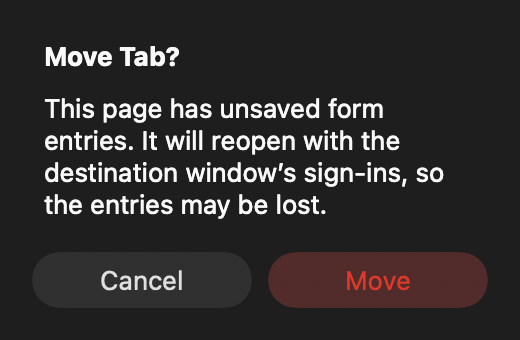

# Window-transfer confirmation

Actual native NSAlert content from isolated XCTest on macOS 27.0.1, with synthetic
form data. The fixture renders the content over the native window background
color because offscreen AppKit material captures otherwise have transparent
backgrounds. These are native content captures, not full browser screenshots.

| Light | Dark |
|---|---|
|  |  |

Reproduce from the repository root:

```sh
BROWSE_MOVE_SCREENSHOTS="$PWD/docs/screenshots/window-transfers" python3 Tests/run-unit-tests.py --filter WindowTransferTests/testNativeAlertCancelKeepsThePage
```

The test invokes the production move path and checks Escape cancels without
transferring the page. Before the repair this path offered no confirmation and
silently replaced the web view. Other transfer regressions run without capturing
images. VoiceOver remains a manual check.
